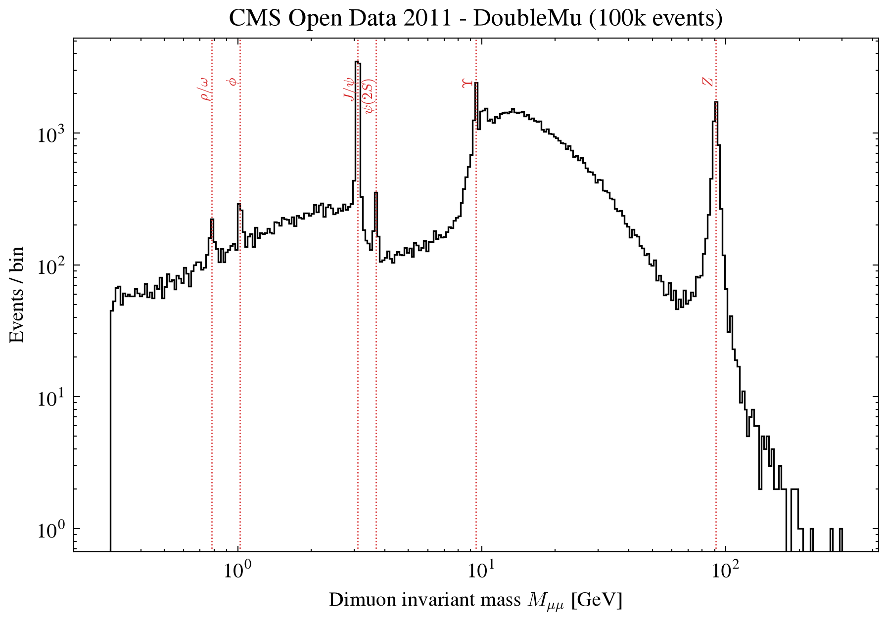

# CMS Dimuon Spectrum and 3D Event Display

Reconstruction of the dimuon invariant mass spectrum from **real CMS collision data** (LHC, 2011, √s = 7 TeV), validation against the official values, and an interactive 3D display of a J/ψ → μ⁺μ⁻ event inside a simplified CMS detector.



## Goal

1. Compute the invariant mass of 100,000 muon pairs and recover the known resonances (J/ψ, Υ, Z, ...) as peaks in a log-log histogram.
2. Validate the computed mass against the mass column provided in the dataset.
3. Visualise one J/ψ event in 3D, with the muon tracks bent by the 3.8 T magnetic field.

## Method

### Invariant mass

For two muons with energies $E_i$ and momenta $\vec p_i$, the invariant mass of the pair is

$$
M^2 = (E_1 + E_2)^2 - \lVert \vec p_1 + \vec p_2 \rVert^2
$$

Writing each muon in detector coordinates ($p_T$, $\eta$, $\varphi$) and neglecting the muon mass ($m_\mu \approx 0.106$ GeV), this becomes

$$
M = \sqrt{\,2\,p_{T1}\,p_{T2}\,\big[\cosh(\eta_1 - \eta_2) - \cos(\varphi_1 - \varphi_2)\big]}
$$

where $p_T$ is the transverse momentum, $\eta$ the pseudorapidity and $\varphi$ the azimuthal angle. Both versions are computed: the second from the `pt`, `eta`, `phi` columns, the first exactly from `E`, `px`, `py`, `pz`.

The histogram uses 300 **logarithmically spaced bins** from 0.3 to 300 GeV, so that narrow low-mass peaks and the wide Z peak are shown with the same visual resolution.

### Event display

In a uniform field $B$ along the beam axis, a muon follows a helix whose transverse radius is

$$
R\,[\mathrm{m}] = \frac{p_T\,[\mathrm{GeV}]}{0.3\,B\,[\mathrm{T}]}, \qquad B = 3.8\ \mathrm{T}
$$

The direction rotates clockwise or anticlockwise depending on the charge $Q = \pm 1$ (Lorentz force). The initial direction comes from the polar angle $\theta = 2\arctan(e^{-\eta})$:

$$
\hat d = (\sin\theta\cos\varphi,\ \sin\theta\sin\varphi,\ \cos\theta)
$$

A random J/ψ candidate is chosen (3.05 < M < 3.15 GeV, 3 < pT < 8 GeV, |η| < 1.2) because its muons have R ≈ 3–7 m, comparable to the detector size, so the bending is clearly visible. The display shows a simplified tracker and solenoid, the collision point, both curved tracks and, as dotted lines, the straight paths the muons would follow without the field.

## Results

### Resonances

The spectrum shows the expected peaks at the PDG masses: ρ/ω (0.78 GeV), φ (1.02 GeV), **J/ψ (3.097 GeV)**, ψ(2S) (3.686 GeV), **Υ (9.46 GeV)** and **Z (91.19 GeV)**. The three Υ states (1S, 2S, 3S) are not fully resolved and appear as one peak with a shoulder. The sharp edge at 0.3 GeV is the dataset selection, and the broad bump around 10–40 GeV is a trigger effect (minimum muon pT), not a resonance.

### Validation against the official mass column

| Method | Mean \|ΔM\| | Max \|ΔM\| | Mean relative |
|---|---|---|---|
| Exact, from (E, px, py, pz) | 0.00037 GeV | 0.83 GeV | 3.5 × 10⁻⁴ |
| Massless, from (pT, η, φ) | 0.029 GeV | 71.6 GeV | 7.1 × 10⁻³ |

The exact method reproduces the official mass up to rounding: **the `M` column was computed from the four-vectors**.

The pT-based method agrees on average, but 371 events differ by more than 1 GeV. Investigating the worst case (event 529: `pt2` = 528 GeV, while √(px² + py²) = 24.2 GeV) showed that **the `pt` column is inconsistent with `px` and `py` in 2.8% (muon 1) and 3.2% (muon 2) of the muons**. The discrepancy comes from that input column, not from the formula. For this reason the exact four-vector mass is used for the histogram, and the event display recomputes pT, η and φ from the momentum components. One event (out of 100,000) is dropped because rounding makes its M² slightly negative.

Full numbers: [`results/validation.txt`](results/validation.txt).

### 3D event display


Each run picks a **random J/ψ candidate** and draws it in an interactive page:

- **Play** animates both muons leaving the collision point at the same speed (≈ c), so the lower-pT muon, which bends more, can leave the detector at a different moment than the other.
- An information panel shows the run and event numbers, the pair mass and, for each muon, pT, η, φ and the curvature radius R.
- The random choice uses a seed that is printed and shown on the page, so any display can be reproduced exactly with `python main.py --seed N`.

In every J/ψ event the two muons bend in opposite directions (opposite charges), and the one with lower pT bends more.

Interactive version: [`figures/event_display_jpsi.html`](figures/event_display_jpsi.html) (download and open in a browser).

## How to run

```bash
git clone https://github.com/joaofilipemartinsdeoliveiragit/cms-dimuon-spectrum.git
cd cms-dimuon-spectrum
pip install -r requirements.txt
python main.py               # random J/psi event, opens the display
python main.py --seed 42     # reproduce a specific event
python main.py --no-browser  # do not open the browser (e.g. on a server)
```

The script downloads the dataset (~13 MB) on the first run, checks that it is complete (100,000 × 21) and writes:

- `figures/dimuon_spectrum.png`
- `figures/event_display_jpsi.html`
- `results/validation.txt`

## Project structure

```
├── main.py              # full analysis, organised in 6 sections
├── requirements.txt
├── figures/             # spectrum (PNG) and event display (HTML)
├── results/             # validation report
└── data/                # dataset, downloaded automatically (not versioned)
```

## Data and citation

This project uses CMS open data:

> McCauley, T. (2019). *Events with two muons from 2011 (Primary dataset DoubleMu 2011A)*. CERN Open Data Portal. https://opendata.cern.ch/record/5201

The dataset contains 100,000 events with two opposite-charge muons (|η| < 2.4, at least one global muon, 0.3 < M < 300 GeV), selected for education and outreach. It is released under the [CC0 1.0](https://creativecommons.org/publicdomain/zero/1.0/) waiver. It is not suitable for a full physics analysis, and neither CMS nor CERN endorse this work.

## Author

João Filipe Martins de Oliveira, Computer Engineering student.
